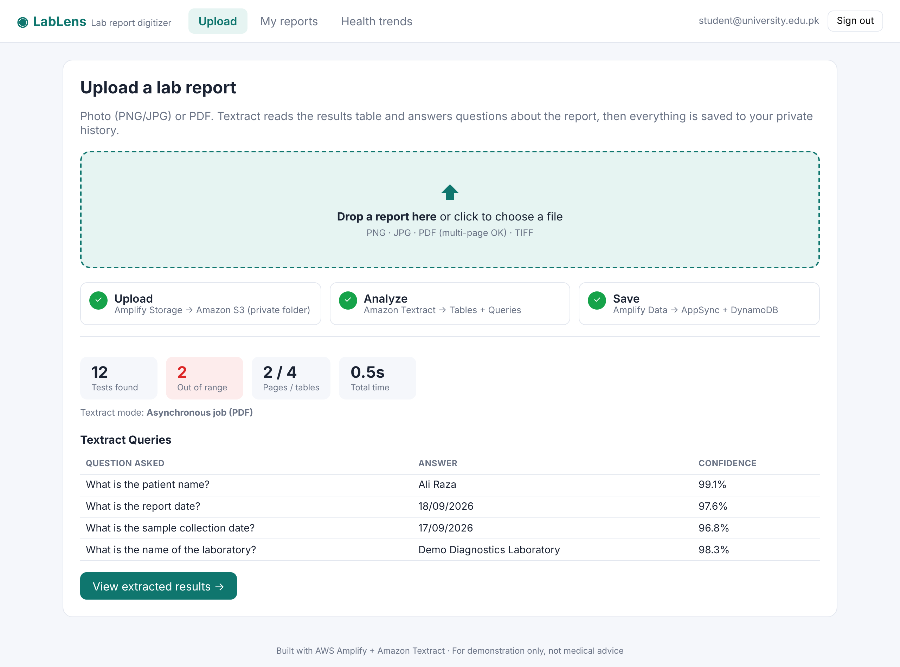

# LabLens: Lab Report Digitizer

**AWS Amplify + Amazon Textract** cloud services presentation project.

Upload a photo or PDF of a lab report. Amazon Textract reads the results table and
answers questions about the report (patient name, date, lab). The app saves every
test value, flags anything outside the normal range, and charts your results over time.



---

## 1. What each service does

| | **AWS Amplify** (builds and runs the app) | **Amazon Textract** (reads the document) |
|---|---|---|
| Role | Full-stack framework: hosting, login, file storage, database, backend function | AI document analysis: text, tables, forms, queries |
| Features used | **Auth** (Cognito sign-up/login with email verification)<br>**Storage** (S3, a private folder per user)<br>**Data** (AppSync GraphQL + DynamoDB, owner-only access, real-time subscriptions)<br>**Functions** (Lambda that calls Textract)<br>**Hosting** (CI/CD from GitHub, every push redeploys) | **TABLES** rebuilds the results table as rows and columns<br>**QUERIES** asks natural-language questions such as "What is the patient name?"<br>**Confidence scores** for every cell and answer<br>**Sync API** (`AnalyzeDocument`) for images<br>**Async API** (`StartDocumentAnalysis` + `GetDocumentAnalysis`) for multi-page PDFs |

### Architecture

```
 Browser (React)
   │  1. sign in ───────────────► Amazon Cognito        (Amplify Auth)
   │  2. upload file ───────────► Amazon S3             (Amplify Storage)
   │                              reports/<user-id>/file
   │  3. processReport(fileKey) ► AWS AppSync ─► AWS Lambda ─► Amazon Textract
   │                                               │  TABLES + QUERIES
   │                                               ▼
   │                                     parser.ts: rows → tests, flags
   │  4. save results ──────────► AppSync ─► Amazon DynamoDB (Amplify Data)
   │  5. live list / charts ◄──── AppSync real-time subscription
   ▼
 Amplify Hosting (CI/CD from GitHub) serves the website
```

### Code map

| File | What it does |
|---|---|
| `amplify/backend.ts` | Combines everything; gives the Lambda Textract permissions and the bucket name |
| `amplify/auth/resource.ts` | Email login (Cognito) |
| `amplify/storage/resource.ts` | S3 bucket; each user can only access their own folder |
| `amplify/data/resource.ts` | Database schema (`Report`, `TestResult`) + `processReport` mutation |
| `amplify/functions/process-report/handler.ts` | Lambda: calls Textract (sync for images, async for PDFs) |
| `amplify/functions/process-report/parser.ts` | Turns Textract blocks into tests; detects headers, parses ranges, flags LOW/HIGH |
| `src/components/UploadPanel.tsx` | Upload → Textract → save pipeline with live progress |
| `src/components/ReportList.tsx` | Real-time list of reports (`observeQuery`) |
| `src/components/ReportDetail.tsx` | Extracted table with flags, confidence and the original file |
| `src/components/Trends.tsx` | Line chart per test with the normal-range band |
| `samples/` | 3 fake lab reports (PNG, JPG "phone photo", 2-page PDF) |

---

## 2. Setup (about 30–45 minutes the first time)

### Prerequisites
- **Node.js 20 or newer** (`node -v`) and **Git**
- A **GitHub** account (for hosting)
- An **AWS account**. Choose the **Paid plan** at sign-up so no service is blocked. Your Free Tier credits (up to $200) still apply.

### Step 1: Protect yourself from charges
AWS Console → **Billing → Budgets → Create budget → "Zero spend" or $5 monthly budget** → enter your email.

### Step 2: Create credentials for your laptop
1. AWS Console → **IAM → Users → Create user** (e.g. `amplify-dev`).
2. **Attach policies directly** → select **`AmplifyBackendDeployFullAccess`** → Create.
3. Open the user → **Security credentials → Create access key → "Command Line Interface"** → copy the Access key ID and Secret.
4. In a terminal:
   ```bash
   npx ampx configure profile
   # paste the keys, choose region: us-east-1
   ```
   Use **us-east-1 (N. Virginia)**, which supports every Textract feature used here.

### Step 3: Install and start the cloud sandbox
```bash
cd lab-report-digitizer
npm install
npx ampx sandbox
```
- The first time, Amplify may ask you to **bootstrap** your account. Follow the link it prints and click *Initialize setup* in the console, then run the command again.
- The first deploy takes **5–10 minutes**. When it says `Deployment completed`, it writes `amplify_outputs.json`.
- **Leave this terminal running.** It watches your backend files and redeploys when you change them.

### Step 4: Run the website locally
In a **second** terminal:
```bash
npm run dev
```
Open http://localhost:5173 → **Create account** → enter the code from your email → upload `samples/report-1-mar-2026.png`.

Then upload the other two samples. Use `report-3-sep-2026.pdf` to show the **async** multi-page job. Open **Health trends** to see the charts.

### Step 5: Deploy to the internet (Amplify Hosting)
1. Create a GitHub repo and push the project:
   ```bash
   git init && git add . && git commit -m "LabLens"
   git branch -M main
   git remote add origin https://github.com/<you>/lab-report-digitizer.git
   git push -u origin main
   ```
2. AWS Console → **AWS Amplify → Create new app → GitHub** → authorize → pick the repo and the `main` branch → **Save and deploy**.
3. In about 5–10 minutes you get a public URL like `https://main.xxxx.amplifyapp.com`.
   The included `amplify.yml` deploys the backend **and** builds the frontend.

> The hosted app has its **own** backend, separate from your sandbox, so create a new account on the live site.

---

## 3. Demo script (6–8 minutes)

1. **Architecture slide** (30s): name each AWS service and its role.
2. **Sign up live** (45s): show the Cognito verification email arriving.
3. **Upload the phone photo** `report-2-jun-2026.jpg` (1 min): point out the 3-step progress (S3 → Textract → DynamoDB) and the **Queries table**, with Textract answering questions in plain English along with confidence %.
4. **Open the results** (1 min): red **High/Low** flags; toggle "only out-of-range"; the ⚠ low-confidence warning; the original image beside it.
5. **Upload the 2-page PDF** (1 min): "Asynchronous job (PDF)"; explain StartDocumentAnalysis → polling → results.
6. **Health trends** (1 min): HbA1c falls from 7.1 → 5.8 over 6 months; the green band is the normal range.
7. **Real-time** (30s): open "My reports" in two browser windows, upload in one, and it appears in the other instantly (AppSync subscription).
8. **CI/CD** (1 min): change a word in `src/App.tsx`, `git push`, and show Amplify building and redeploying.
9. **Behind the scenes** (1 min): AWS Console → CloudWatch logs of the Lambda (`Textract returned N blocks in X ms`), the DynamoDB table items, and the S3 folders per user.

**Backup:** record a screen video of the full demo the day before, in case the internet fails.

---

## 4. Likely Q&A questions

- **How is Textract different from normal OCR?** OCR only gives text. Textract also understands **structure** (tables, key-value forms) and answers **queries**, with a confidence score for each item.
- **Why both sync and async APIs?** Sync (`AnalyzeDocument`) handles single images and returns immediately. Multi-page PDFs need the async job API (`StartDocumentAnalysis`), which you poll until it finishes. Results come in pages linked by `NextToken`.
- **How do you know which column is which?** `parser.ts` looks for header words (Test / Result / Unit / Reference Range). Tables continued on the next page without a header reuse the previous column layout, but only if most rows contain numbers.
- **How is data kept private?** S3 paths are `reports/<identity-id>/` with IAM rules per user, and the database uses `allow.owner()`, so each user only ever sees their own records. All of this is enforced by AWS, not by the frontend.
- **What does Amplify actually create?** A set of nested CloudFormation stacks (auth, data, storage): a Cognito user pool and identity pool, an S3 bucket, an AppSync API, 2 DynamoDB tables, a Lambda, and IAM roles. You can see them in the CloudFormation console.
- **What if Textract misreads a value?** Every value keeps its confidence score. Anything below 90% is marked ⚠ for manual checking.
- **Cost?** Textract bills per page analysed (Tables + Queries); see aws.amazon.com/textract/pricing. The rest falls within free usage levels for a demo, and the sandbox costs almost nothing when idle.
- **Limitations / future work:** handwritten reports, qualitative results ("Negative") are skipped, a different reference range per age/sex, and a Textract **adapter** (custom training) for unusual lab layouts.

---

## 5. Clean up after the presentation
```bash
npx ampx sandbox delete        # removes the sandbox backend
```
AWS Console → Amplify → your app → **App settings → General → Delete app**.

## 6. Troubleshooting
| Problem | Fix |
|---|---|
| `amplify_outputs.json` not found | Run `npx ampx sandbox` first and wait for "Deployment completed" |
| Sandbox asks to bootstrap | Open the printed link → *Initialize setup* → rerun |
| `AccessDenied` / "Unable to get object metadata from S3" | Bucket and Textract must be in the same region; use one region throughout |
| `UnsupportedDocumentException` | Use PNG/JPG/PDF/TIFF under 10 MB (images) |
| Report stuck on "Processing" | Check the Lambda logs: CloudWatch → Log groups → `/aws/lambda/...process-report...` |
| No tests found | The report's table needs a header row with "Test" and "Result"/"Value" columns |

## 7. Run the parser test (no AWS needed)
```bash
npm run test:parser
```

> All sample reports are fictional and for software testing only. This app is not a medical device.
